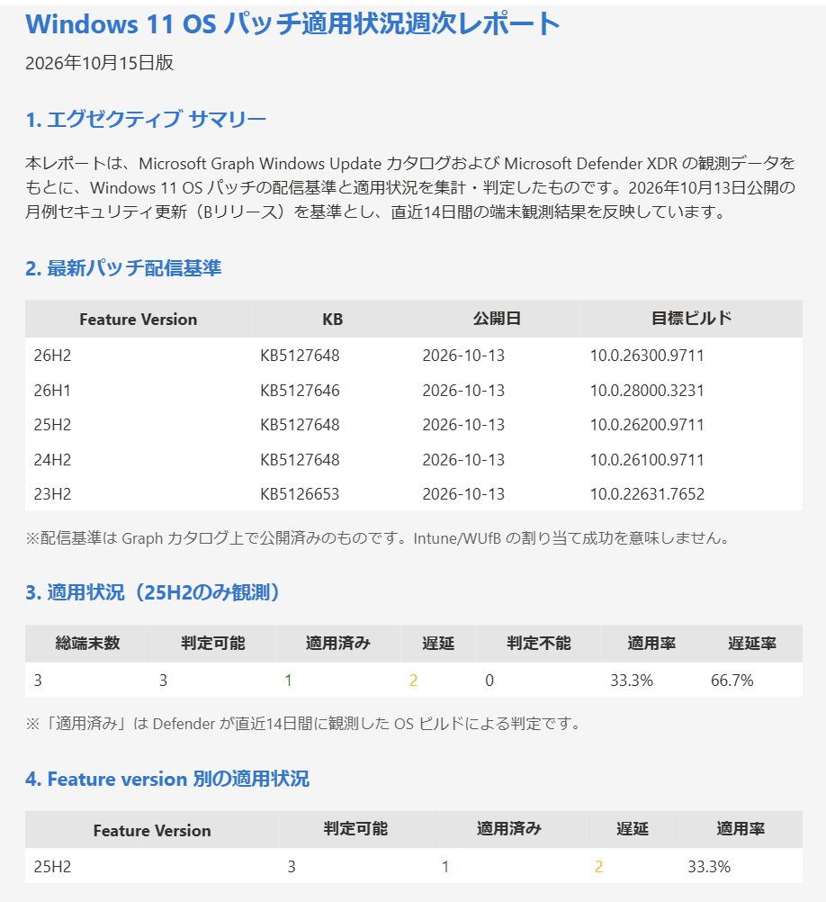
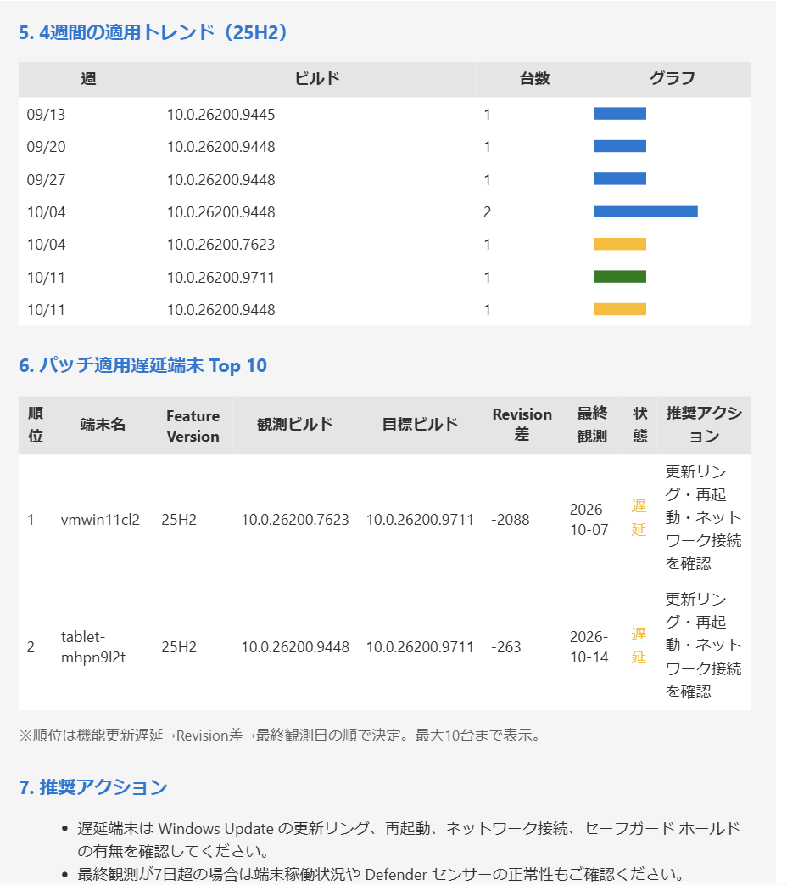

# Weekly Windows 11 Patch Report

Microsoft Graph Windows Updates カタログの最新品質更新と、Microsoft Defender XDR
`DeviceInfo` の Windows 11 OS ビルドを週次で突合し、HTML メールを送信する
Security Copilot Standard Agent です。

## 実際の生成例

本エージェントで生成したHTMLレポートの表示例です。画像内の更新情報・端末・集計値は
生成時点のものであり、実行日時や対象環境によって変わります。

### サマリー・配信基準・適用状況



### 適用トレンド・遅延端末Top 10・推奨アクション



## 確定構成

2026-10-15時点の導入手順です。導入先でエージェントの実行とレポート生成を確認し、
Graph取得件数の上限とDeviceInfoのRevision取得方法を反映しています。

| 項目 | 確定値・方式 |
|---|---|
| Defenderの認証 | エージェントの代理ユーザーによるAdvanced Hunting |
| Graphの認証 | 専用EntraアプリのOAuth 2.0 Client Credentials |
| Graphの最小権限 | Application permission `WindowsUpdates.Read.All`、管理者同意必須 |
| Tenant ID | 生成スクリプトの`-TenantId`へ指定 |
| アップロード対象 | 生成した`WeeklyWindows11PatchReport.local.yaml`だけ |
| OAuthのResource | `https://graph.microsoft.com`（`/.default`なし） |
| マニフェスト内のScopes | `https://graph.microsoft.com/.default` |
| Graph取得件数 | `$top=5`、最大5（OpenAPI 1.2） |
| 端末のRevision | `DeviceInfo.OsBuildRevision`を優先、完全な`OSVersion`を代替に使用 |
| メール送信 | Deploy to Azureで展開したLogic Appと、認証済みのOffice 365 API接続 |
| 実行間隔 | 604,800秒（7日）。固定の曜日・時刻やJSTタイムゾーンを指定する設定ではない |

初めて導入する場合は、[前提条件](#前提条件)と[認証アーキテクチャと最小権限](#認証アーキテクチャと最小権限)を
確認した後、[導入手順](#導入手順)を順番に実施してください。
稼働中の環境を更新する場合は、[更新と運用](#更新と運用)を参照してください。

## 分析内容

- Windows 11 feature version ごとの最新月例セキュリティ更新（KB、公開日、目標ビルド）
- Defender が直近 14 日に観測した適用済み、遅延、判定不能の端末数
- 判定可能端末を分母にした適用率と遅延率
- 4 週間の OS ビルド分布と適用トレンド
- feature version 別の適用状況
- パッチ適用遅延端末 Top 10
- 優先度付き推奨アクション

## 判定モデル

| 状態 | 判定 |
|---|---|
| 適用済み | 同じ feature version / buildNumber の Defender Revision が Graph 最新基準以上 |
| 遅延 | 同じ buildNumber で update build revision が最新基準未満 |
| 機能更新遅延 | サービス終了など、機能更新が必要と確認できた旧feature version。Graph基準がないだけでは判定しない |
| 判定不能 | Graph 基準、対応build、Revisionが不足、またはRevisionの情報が不整合 |

`適用率 = 適用済み / 判定可能端末`、`遅延率 = 遅延端末 / 判定可能端末`
として算出します。判定不能端末は分母から除外し、別のデータ品質指標として表示します。
判定不能・適用済み端末は「パッチ適用遅延端末 Top 10」に含めません。

### OS Revisionの取得方法

`DeviceInfo.OSVersion`が`10.0`だけでも、`OSBuild`と`OsBuildRevision`で判定できます。
例えば`OSVersion=10.0`、`OSBuild=26200`、`OsBuildRevision=9711`は
`FullOSVersion=10.0.26200.9711`として表示します。

| RevisionSource | 意味 |
|---|---|
| `OsBuildRevision` | 専用列の有効な非負整数を優先して使用 |
| `OSVersion` | 専用列から取得できない場合に、完全な4要素のOSVersionから抽出 |
| `Unavailable` | どちらからも取得できない。Revisionはnull |
| `Conflict` | 専用列とOSVersionのRevision、またはOSVersionのbuildとOSBuildが不一致。判定不能 |

3つのKQLスキルで同じ抽出・検証処理を使用します。最新レコードの専用列が空だからといって
過去の別レコードからRevisionを補いません。トレンドはその週の最新レコードを使用します。
欠損時に`-1`を設定する旧処理は廃止し、未取得を実際のOSバージョンとして表示しません。
OSVersionやOsBuildRevisionの元の値も、診断用に返します。

同じ`DeviceInfo`を使うため、この修正に追加のGraph権限やTVM権限は必要ありません。
最新のマニフェストを再登録または更新し、KQLの3スキルを単独実行してから
エージェントの集計・レポートを確認してください。

Revision番号差は未適用パッチ件数や月例更新の未適用月数ではありません。
判定は観測時点のビルドと現在の目標との比較です。基準公開前の観測や7日超の古い観測は
鮮度注意を付け、現在の端末状態として断定しません。

> Graph カタログの「配信済み」は Microsoft が更新を公開済みであることを示します。
> Intune / Windows Update for Business の割り当て成功やダウンロード成功を直接示すものでは
> ありません。「適用済み」は Defender が直近 14 日に観測した OS ビルドによる判定です。

## ファイル

| ファイル | 用途 |
|---|---|
| `WeeklyWindows11PatchReport.yaml` | プラグイン マニフェストの公開テンプレート。Agent、KQL、Graph API、Logic App スキルを定義。直接アップロードしない |
| `New-WeeklyWindows11PatchReportManifest.ps1` | `-TenantId`からアップロード用マニフェストを生成 |
| `Test-WeeklyWindows11PatchReportGraph.ps1` | 同じサービスプリンシパルでGraphへ直接要求し、400のエラー本文を切り分け。PowerShell 7以降が必要 |
| `WeeklyWindows11PatchReport.local.yaml` | **Security Copilot にアップロードする生成済みマニフェスト**。ローカルで生成し、公開GitHubには保存しない |
| `WeeklyWindows11PatchReport_GraphAPI_openapi.yaml` | Graph beta API の OpenAPI 3.0 仕様。マニフェストから HTTPS で参照するファイルであり、Security Copilot へ直接アップロードしない |
| `WeeklyWindows11PatchReport_LogicApp_ARM.json` | Office 365 メール送信用 Logic App |
| `WeeklyWindows11PatchReport_SampleEmail.html` | 架空データによるレポート表示例 |
| `WeeklyWindows11PatchReport_card.html` | プラグイン カード |

> **重要:** Security Copilot の「カスタム プラグインの追加」で選択するファイルは
> `-TenantId`を指定して生成した`WeeklyWindows11PatchReport.local.yaml`です。
> `WeeklyWindows11PatchReport_GraphAPI_openapi.yaml` を直接選択すると、このファイルには
> Security Copilot の `Descriptor` がないため、
> `2002: Failed to load yaml: No SkillsetDescriptor is specified` が発生します。

## 前提条件

1. Security Copilot で Microsoft Defender XDR プラグインが有効
2. Defender for Endpoint に端末がオンボード済み
3. 専用EntraアプリにGraphアプリケーション権限 `WindowsUpdates.Read.All` を付与し、管理者同意済み
4. メール送信用 Logic App と Office 365 接続が利用可能
5. Security Copilot から GitHub raw の OpenAPI URL へ HTTPS アクセス可能
6. カスタムプラグインの登録とエージェント設定を行える権限
7. AzureでLogic AppとOffice 365 API接続を作成できる権限、および送信用Microsoft 365アカウント
8. ローカルでPowerShellが利用可能。診断スクリプトにはPowerShell 7以降が必須

Microsoft Graph `/beta` API は変更される可能性があり、本番利用は Microsoft のサポート対象外です。
運用前と Graph API 変更時に OpenAPI 応答スキーマを再確認してください。

## 認証アーキテクチャと最小権限

このエージェントは、用途の異なる3つの認証主体を使用します。権限を混在させないでください。

| 認証主体 | 用途 | 対象サービス | 認証方式 |
|---|---|---|---|
| Security Copilotの代理ユーザー | KQLスキルによる`DeviceInfo`のAdvanced Hunting | Microsoft Defender XDR | Security Copilotの代理認証 |
| Graph用サービスプリンシパル | Windows 11の最新品質更新とproduct revisionの取得 | Microsoft Graph | OAuth 2.0 Client Credentials |
| Office 365 API接続のユーザー | HTMLレポートのメール送信 | Exchange Online | Logic AppのOffice 365接続 |

```text
Security Copilot Agent
  |-- 代理ユーザー -----------------> Defender XDR Advanced Hunting
  |                                    DeviceInfoの読み取り
  |
  |-- 専用サービスプリンシパル -----> Microsoft Graph
  |                                    Windows Updates catalogの読み取り
  |
  `-- Logic App ---------------------> Office 365 API接続
                                       HTMLメールの送信
```

### 1. Security Copilot代理認証: Defender Advanced Hunting

カスタムエージェント自体の実行には、Security Copilotのエージェント設定画面で
既存ユーザーを割り当てる代理認証を使用します。このユーザーの権限で、マニフェスト内の
Defender KQLスキルが`DeviceInfo`を照会します。

個人の管理者アカウントではなく、エージェント専用ユーザーを推奨します。代理認証は
Security Copilot画面に表示される有効期限を基準に再認証してください
（検証環境では90日）。Graph用サービスプリンシパルとは別の認証です。

#### 推奨: Microsoft Defender統合RBAC

最小権限は、Microsoft Defender統合RBACのカスタムロールで次だけを付与する構成です。

| 設定 | 値 |
|---|---|
| Permission group | Security operations |
| Permission category | Security data |
| Permission | Security data basics |
| Level | Read |
| Data source | Microsoft Defender for Endpoint |
| Assignment | 代理認証に使用するユーザー、またはそのユーザーだけを含むグループ |
| Device group scope | 全社レポートでは全対象デバイス グループ。限定レポートでは必要なグループだけ |

`Security data basics (Read)`は、Advanced Hunting、デバイス、インシデント、アラート、
調査、レポートなどの読み取りを許可します。本エージェントは読み取り専用であり、
次のManage権限は不要です。

- Alerts (Manage)
- Response (Manage)
- Basic / Advanced live response (Manage)
- Detection rule management
- File collection

本エージェントの現在のKQLは`DeviceInfo`だけを使用するため、
`Vulnerability management (Read)`も不要です。将来、`DeviceTvm*`テーブルを追加する場合は、
Defender Vulnerability Managementデータへのアクセス要件を改めて評価してください。

全社のWindows 11端末を集計するには、代理ユーザーのデバイス グループ スコープに
全対象端末が含まれている必要があります。スコープを限定すると、レポートの母数とTop 10も
そのスコープ内の端末だけになります。

#### 代替: Microsoft Entraロール

統合RBACを使用しない場合は、代理ユーザーにMicrosoft Entraの
`Security Reader`ロールを割り当てます。これはAdvanced Huntingを含むDefender XDRの
読み取り用途で使用できる最小権限の組み込みEntraロールです。

| Entraロール | 利用可否 | 備考 |
|---|---|---|
| Security Reader | 推奨可能 | 読み取り専用。Entraロール パターンの最小権限 |
| Global Reader | 利用可能だが非推奨 | Defender以外も広く読み取れるため過剰 |
| Security Operator | 不要 | 操作権限を含み、本エージェントには過剰 |
| Security Administrator | 不要 | 管理権限を含み、本エージェントには過剰 |
| Global Administrator | 使用禁止 | 日常実行には過剰。緊急管理用途に限定 |

最小権限とデバイス グループ単位のスコープ制御が可能なため、Entraロールより
Defender統合RBACを優先してください。

### 2. サービスプリンシパル: Microsoft Graph Windows Updates

Windows 11の最新パッチ情報は、代理ユーザーではなく専用Entraアプリの
サービスプリンシパルで取得します。

> この認証はOpenID Connectではなく、**OAuth 2.0 Client Credentials Flow**です。
> ユーザーのサインインやIDトークンは使用せず、サービスプリンシパルが
> Microsoft Graph用アクセストークンを取得します。

#### 最小権限

| 設定 | 値 |
|---|---|
| API | Microsoft Graph |
| Permission type | Application |
| Permission | `WindowsUpdates.Read.All` |
| Admin consent | 必須 |
| Entraディレクトリ ロール | 不要 |
| Resource | `https://graph.microsoft.com` |
| OAuth scope | `https://graph.microsoft.com/.default` |
| API endpoint | `GET /beta/admin/windows/updates/catalog/entries` |

`WindowsUpdates.ReadWrite.All`は付与しないでください。本エージェントはカタログを
読み取るだけで、更新プログラムの展開や管理操作を行いません。

#### Graph用Entraアプリの作成

1. Microsoft Entra管理センターで「アプリの登録」→「新規登録」を選択
2. 名前を`SecurityCopilot-WeeklyWindows11PatchReport`などに設定
3. 「この組織ディレクトリのみに含まれるアカウント」を選択
4. リダイレクトURIは設定せず登録
5. 「APIのアクセス許可」→「Microsoft Graph」→「アプリケーションの許可」を選択
6. `WindowsUpdates.Read.All`だけを追加
7. テナントの管理者同意を付与
8. 「証明書とシークレット」でクライアントシークレットを作成し、値を安全に保管

クライアントシークレットをマニフェストやGitHubへ記載しないでください。有効期限を監視し、
期限前にローテーションしてください。

#### Security CopilotのOAuthセットアップ

`Resource`は固定値ですが、現在のSecurity Copilotでは認証セットアップ時の必須入力欄です。
公開マニフェスト仕様に`Resource`の事前設定フィールドがないため、画面で1回入力します。

| 画面の項目 | 入力する値 |
|---|---|
| Token endpoint | 生成済みマニフェストに設定済み。画面に表示される場合は、実際のTenant IDを含むURLであることを確認 |
| ClientId | 作成したEntraアプリのApplication (client) ID |
| ClientSecret | 作成したクライアントシークレットの**値** |
| Resource | `https://graph.microsoft.com` |

`Resource`には`/.default`や`/beta`を付けません。Microsoft GraphのアプリケーションIDや
`WindowsUpdates.Read.All`も入力しません。

Tenant IDは公開テンプレートへ埋め込みません。アップロード前に、生成スクリプトの
`-TenantId`パラメーターへDirectory (tenant) IDを渡します。たとえばTenant IDが
`11111111-2222-3333-4444-555555555555`の場合、生成されたマニフェストには次のURLが設定されます。

```text
https://login.microsoftonline.com/11111111-2222-3333-4444-555555555555/oauth2/v2.0/token
```

Security Copilotのプラグインマニフェストには、Tenant IDだけを受け取って
`TokenEndpoint`へ文字列展開する仕組みには依存しません。
本構成では、生成スクリプトがTenant IDをURLへ埋め込んだマニフェストを作成します。
`TokenEndpoint`は削除せず、認証画面で後から入力する方式も使用しません。

公開テンプレートには次が設定されています。このテンプレート自体はアップロードしないでください。

```yaml
SupportedAuthTypes:
  - OAuthClientCredentialsFlow
Authorization:
  Type: OAuthClientCredentialsFlow
  TokenEndpoint: https://login.microsoftonline.com/<YOUR-TENANT-ID>/oauth2/v2.0/token
  Scopes: https://graph.microsoft.com/.default
  AuthorizationContentType: application/x-www-form-urlencoded
```

### 3. Logic App: Office 365メール送信

Logic AppのOffice 365 API接続は、上記2つの認証とは別です。デプロイ後に、メール送信に
使用するアカウントでAPI接続を認証します。このアカウントには、指定された送信元として
メールを送信できる権限だけを付与してください。

## 導入手順

### 1. 成果物と認証主体の準備

リポジトリを取得します。Gitを使用する場合は次を実行します。
Gitがない場合はGitHubの「Code」からZIPをダウンロードして展開してください。

```powershell
git clone https://github.com/hisashin0728/SecurityCopilot-WeeklyWindows11PatchReport.git
Set-Location .\SecurityCopilot-WeeklyWindows11PatchReport
```

次のファイルが同じフォルダーにあることを確認します。

- [マニフェストの公開テンプレート](./WeeklyWindows11PatchReport.yaml)
- [マニフェスト生成スクリプト](./New-WeeklyWindows11PatchReportManifest.ps1)
- [Graph診断スクリプト](./Test-WeeklyWindows11PatchReportGraph.ps1)

前述の認証・最小権限の手順に従い、Defender用の代理ユーザーとGraph用Entraアプリを準備します。
生成・診断に使用するTenant ID、Application (client) IDを控えます。
Client Secretは安全に保管し、共有リポジトリやマニフェストへ記載しないでください。

### 2. Logic Appの展開とOffice 365接続の認証

[](https://portal.azure.com/#create/Microsoft.Template/uri/https%3A%2F%2Fraw.githubusercontent.com%2Fhisashin0728%2FSecurityCopilot-WeeklyWindows11PatchReport%2Frefs%2Fheads%2Fmain%2FWeeklyWindows11PatchReport_LogicApp_ARM.json)

上の **Deploy to Azure** ボタンを選択し、Azure ポータルで次を指定してデプロイします。

1. サブスクリプション
2. リソース グループ
3. リージョン
4. 送信先メールアドレス
5. Logic App 名（既定値: `PluginLogicApp_WeeklyWindows11PatchReport`）
6. Office 365接続名（既定値: `office365`）。既存の接続と区別する必要があれば別名を指定

デプロイ後、Azure ポータルで作成された Office 365 API 接続を開き、
送信に使用するアカウントで認証してください。ARM テンプレートのデプロイだけでは
Office 365 接続のサインインは完了しません。
続いて、Logic AppのSubscription ID、Resource Group、Workflow Nameを控えます。
Workflow NameはOffice 365接続名ではなく、展開したLogic Appリソースの名前です。

ボタンが利用できない場合は、
[Azure ポータルでカスタム テンプレートを開く](https://portal.azure.com/#create/Microsoft.Template/uri/https%3A%2F%2Fraw.githubusercontent.com%2Fhisashin0728%2FSecurityCopilot-WeeklyWindows11PatchReport%2Frefs%2Fheads%2Fmain%2FWeeklyWindows11PatchReport_LogicApp_ARM.json)
リンクを直接使用してください。

### 3. Graph認証とAPIの疎通確認

PowerShell 7以降で、Security Copilotに設定するものと同じEntraアプリを使用して確認します。
以下のTenant IDとClient IDは例です。実際の値へ変更してください。

```powershell
.\Test-WeeklyWindows11PatchReportGraph.ps1 `
  -TenantId '11111111-2222-3333-4444-555555555555' `
  -ClientId 'aaaaaaaa-bbbb-cccc-dddd-eeeeeeeeeeee'
```

Client Secretの**値**を非表示の入力欄へ入力し、5ケースすべてがHTTP 200になることを確認します。
失敗した場合は、[トラブルシューティング](#トラブルシューティング)で原因を解消してから進みます。
この診断はメール送信や更新プログラムの変更を行いません。

#### OpenAPI参照先

マニフェストには、GitHub raw の公開済み OpenAPI URL が設定されています。

```yaml
OpenApiSpecUrl: https://raw.githubusercontent.com/hisashin0728/SecurityCopilot-WeeklyWindows11PatchReport/refs/heads/main/WeeklyWindows11PatchReport_GraphAPI_openapi.yaml
```

通常は書き換え不要です。リポジトリを fork して内容を変更する場合だけ、
fork 先の raw URL に変更してください。

OpenAPI ファイル単体は Security Copilot のプラグイン マニフェストではありません。
Security Copilot は `WeeklyWindows11PatchReport.yaml` の `OpenApiSpecUrl` を読み取り、
実行時にこの OpenAPI ファイルを HTTPS で取得します。

### 4. Tenant IDを指定してアップロード用マニフェストを生成

手順1で取得したフォルダーで、[生成スクリプト](./New-WeeklyWindows11PatchReportManifest.ps1)を
実行します。例のGUIDは実際のDirectory (tenant) IDへ変更してください。

```powershell
.\New-WeeklyWindows11PatchReportManifest.ps1 -TenantId '11111111-2222-3333-4444-555555555555'
```

生成される`WeeklyWindows11PatchReport.local.yaml`は、Tenant IDを設定済みのアップロード用
マニフェストです。既存ファイルは上書きしません。再生成する場合は`-OutputPath`で別名を指定します。
既定の生成ファイルは`.gitignore`で除外しています。別名で生成したファイルも公開GitHubへ
コミットしないでください。Client Secretは生成ファイルへ記載しません。

生成されたファイルの`TokenEndpoint`が、実際のTenant IDを含む
`https://login.microsoftonline.com/<実際のTenant ID>/oauth2/v2.0/token`になっていることを確認します。
実ファイルには`<`と`>`を残しません。

### 5. Security Copilotへの登録と設定

1. Security Copilotで「カスタム プラグインの追加」を開く
2. **生成された`WeeklyWindows11PatchReport.local.yaml`だけ**をファイルとしてアップロード
3. プラグインのOAuth認証に、手順3と同じClient ID、Client Secretの**値**、
   Resource=`https://graph.microsoft.com`を設定
4. 次のLogic App設定を入力
5. エージェントの代理認証に、Advanced Hunting読み取り権限を持つユーザーを割り当て

| プラグインの設定項目 | 設定値 |
|---|---|
| `LogicAppSubscriptionId` / Logic App Subscription ID | 手順2で控えたAzureサブスクリプションID |
| `LogicAppResourceGroup` / Logic App Resource Group | Logic Appが存在するリソースグループ名 |
| `LogicAppWorkflowName` / Logic App Workflow Name | Logic Appリソース名。既定値は`PluginLogicApp_WeeklyWindows11PatchReport` |

Graph認証はプラグインのAPI認証、Defender認証はエージェントの代理認証です。
代理認証の画面にClient IDやClient Secretを設定するものではありません。
メールの送信先はLogic Appの`emailAddress`で設定し、マニフェスト生成の引数には指定しません。

### 6. 初回実行と週次運用の開始

最初に各スキルを単独で実行し、その後エージェント全体を手動で実行します。
メール送信スキルは実際にメールを送信するため、宛先を確認してから実行してください。

| 確認対象 | 期待する結果 |
|---|---|
| `ListWindowsQualityUpdates` | 400/401/403なく品質更新カタログとproductRevisionsを取得できる |
| `GetWindows11PatchInventory` | `Revision`、`RevisionSource`、`FullOSVersion`を含む台数集計が返る |
| `GetWindows11PatchTrend` | 週別のOSBuild / Revision分布が返る |
| `GetWindows11PatchLagCandidates` | 元のOSVersionが`10.0`でも、専用列の値からRevisionを取得できる |
| `SendWeeklyWindows11PatchReportEmail` | 短いテストHTMLを`ReportHtml`へ渡し、Logic Appが正常終了して宛先へメールが届く |
| エージェント全体 | HTMLレポートが生成・送信され、適用済み・判定不能が遅延Top 10に混在しない |

対象データが存在しない場合は「該当なし」、取得に失敗した場合は「取得不可」と
理由が表示されることを確認します。適用率・遅延率は判定可能端末がある場合に確認します。
Logic Appの実行履歴、メール本文、観測日時の注意書きまで確認してから週次実行を有効化します。

実行間隔は604,800秒（7日）です。毎週月曜日の特定時刻などを保証する設定ではありません。
実際の次回実行予定はSecurity Copilotの画面で確認してください。

## 更新と運用

### マニフェスト・OpenAPIの更新

1. 更新前に、代理ユーザー、プラグインの認証・Logic App設定、スケジュールを控える
2. 公開テンプレートと関連ファイルを最新化する。Gitの場合は公開ファイルにローカル変更がないことを確認して`git pull --ff-only`を実行
3. 新しいテンプレートから、同じTenant IDと別の出力ファイル名で再生成する

   ```powershell
   .\New-WeeklyWindows11PatchReportManifest.ps1 `
     -TenantId '11111111-2222-3333-4444-555555555555' `
     -OutputPath '.\WeeklyWindows11PatchReport.updated.local.yaml'
   ```

4. 生成した新しいファイルで、登録済みのプラグイン／エージェントを更新する
5. 再登録が必要な場合は旧エージェントを停止し、重複実行・二重送信を避ける。認証とLogic App設定を再確認する
6. 初回と同じ単独スキル・レポート確認を行い、週次実行を再開する

既存の生成済みマニフェストは自動更新されません。スクリプトは既存ファイルを上書きしません。
`-OutputPath`で指定した別名ファイルは、既定の`.gitignore`では除外されない場合があるため、
公開GitHubへ追加しないでください。

OpenAPIはGitHub rawを参照します。ローカルのOpenAPIだけを編集しても参照先は更新されません。
公開側の更新後はプラグイン定義を再読み込みさせるために更新／再登録し、単独スキルで確認します。
既に正常稼働している場合、READMEだけの更新でプラグインを再登録する必要はありません。

### 定期的な確認

- Security Copilot代理認証の有効期限と、Graph用Client Secretの有効期限を別々に管理する
- Secret更新時はプラグインの認証設定を更新し、Graphスキルの疎通を確認する
- Office 365接続の認証状態、Logic Appの実行失敗、メール到着を確認する
- Defenderの判定不能率、古い観測、取得上限到達を監視する。センサー状態がActiveでも観測日時が新しいとは限らない
- 判定不能を解消するために欠損値を0や最新版とみなしたり、不要なGraph書き込み権限を追加したりしない

## トラブルシューティング

### Graphカタログ取得時の `400 BadRequest`

トークン取得処理ではなく、GraphへのGET要求で返るエラーです。400だけでは原因を
確定できません。Graph応答の`error.code`と`error.message`、実際に送信された
クエリーパラメーターを確認します。アクセストークンやClient Secretは共有しないでください。

直接診断では、クエリーなしの要求は200、上限を超えた`$top=12`の要求は400で、
次のエラーメッセージが返ることを確認しました。

```text
The query specified in the URI is not valid.
The limit of '5' for Top query has been exceeded.
The value from the incoming request is '12'.
```

このエラーの原因は`$top`の上限超過です。認証や権限不足ではありません。
OpenAPI 1.2では`$top`の既定値と最大値をともに5へ変更し、マニフェストと診断スクリプトも
`$top=5`へ統一しています。認証設定やフィルターの変更では上限超過は解消しません。

確定した要求は次のとおりです。品質更新の型判定とproductRevisions展開、
公開日時の降順を指定し、セキュリティ更新の選別は応答取得後に行います。

| パラメーター | 値 |
|---|---|
| `$top` | `5`（最大5） |
| `$filter` | `isof('microsoft.graph.windowsUpdates.qualityUpdateCatalogEntry')` |
| `$expand` | `microsoft.graph.windowsUpdates.qualityUpdateCatalogEntry/productRevisions` |
| `$orderby` | `releaseDateTime desc` |

パラメーター値には、`$filter=`などのキー、バッククォート、手動でURLエンコードした値を
含めません。応答に`@odata.nextLink`がある場合、取得したページだけが分析対象です。
基準が取得できなかったfeature versionを適用済みとは判定しません。

OpenAPIはGitHub raw URLから読み込まれるため、ローカルのOpenAPIだけを変更しても
登録済みプラグインへは反映されません。公開OpenAPIを更新したうえで、更新済みマニフェストを
再登録または更新し、`ListWindowsQualityUpdates`を単独実行してからエージェントを実行します。

それでも400が返る場合は、Graph応答の`error.code`と`error.message`および
実際のクエリーパラメーターを確認し、原因を切り分けます。読み取り要求の400を理由に
`WindowsUpdates.ReadWrite.All`へ権限を拡大しないでください。

#### 400が継続する場合の直接診断

`$top=5`でも400が継続する場合は、追加のクエリー変更や再登録を繰り返す前に、
Security Copilotに設定したものと同じ
専用Entraアプリを使用し、[診断スクリプト](./Test-WeeklyWindows11PatchReportGraph.ps1)で
Graphの応答を確認します。PowerShell 7以降で、次のGUIDを実際の値に変更して実行します。

```powershell
.\Test-WeeklyWindows11PatchReportGraph.ps1 `
  -TenantId '11111111-2222-3333-4444-555555555555' `
  -ClientId 'aaaaaaaa-bbbb-cccc-dddd-eeeeeeeeeeee'
```

Client Secretの**値**は、実行時の非表示入力へ入力してください。コマンドライン引数、
ファイル、チャットに記載しないでください。スクリプトはアクセストークンを表示せず、
レポートの送信や更新の変更も行いません。

| テスト | 要求 |
|---|---|
| 1 | クエリーパラメーターなし |
| 2 | `$top`のみ |
| 3 | `$top` + `$filter` |
| 4 | `$top` + `$filter` + `$expand` |
| 5 | 現在のエージェントと同じ全パラメーター |

400の場合は`error.code`、`error.message`、要求URL、request IDを表示して次のケースへ
進みます。400以外のエラーや認証失敗では停止します。失敗したケースがある場合は、
最後にもエラーを返します。HTMLなどの非JSON応答は本文を表示せず、Content-Typeを表示します。

- 1から400: OData条件だけでは説明できません。Graphのエラー本文に基づいて調査します。
- ある段階から400: その段階で追加したパラメーターが切り分け対象になります。
- 全件200でCopilotだけ400: Copilotの実際のスキル入力、読み込まれたOpenAPI、
  クエリーのシリアライズ、認証設定の差を確認します。直接診断の成功だけでCopilotの成功とはみなしません。
- 401/403: 認証・権限・管理者同意を調べます。400と分けて扱います。

診断結果を共有する場合は、ケース名、HTTP状態、`error.code`、`error.message`、
request IDだけを共有してください。Client SecretやAuthorizationヘッダーは共有しないでください。

### `2002: Failed to load yaml: Value cannot be null. (Parameter 'uriString')`

今回の環境では、`Authorization.TokenEndpoint`を省略したマニフェストで発生しました。
`TokenEndpoint`を削除して認証画面で後から入力する方式は使用しないでください。

最新テンプレートと生成スクリプトを取得し、`-TenantId`を指定して生成した
`WeeklyWindows11PatchReport.local.yaml`をアップロードします。
YAMLの構文チェックだけではSecurity Copilotの登録要件を検証できません。

### `AADSTS65002: Consent between first party application ... must be configured via preauthorization`

Security CopilotのMicrosoft管理ファーストパーティ アプリから、Microsoft Graphの
`WindowsUpdates.Read.All` を代理認証で要求した場合に発生します。ファーストパーティ
アプリ間の権限はMicrosoft側の事前承認が必要で、テナント管理者の同意だけでは解消できません。

本リポジトリの最新マニフェストは、この制約を回避するため
`OAuthClientCredentialsFlow` を使用します。

1. 以前登録したプラグイン／エージェントを削除または更新
2. 最新テンプレートと生成スクリプトで、`-TenantId`を指定して生成したマニフェストをアップロード
3. 専用EntraアプリのClient ID、Client Secret、Resourceを設定
4. エージェントの代理ユーザー認証も再設定
5. `ListWindowsQualityUpdates` を再実行

### `Unexpected character encountered while parsing value: <`

```text
Newtonsoft.Json.JsonReaderException:
Unexpected character encountered while parsing value: <
OAuthClientCredentialFlowAuthHandler.GetHttpAuthorizationHeaderAsync
```

Security CopilotがOAuthトークンエンドポイントの応答をJSONとして解析しようとしましたが、
応答の先頭が`<`、つまりHTMLだった場合に発生します。クライアントIDやGraph権限ではなく、
TokenEndpointのURL誤りで発生することが多いエラーです。

公開テンプレートのToken endpointには`<YOUR-TENANT-ID>`が残っています。
テンプレートを直接アップロードせず、`-TenantId`を指定して生成したマニフェストを使用します。
生成されたURLに山括弧`<`と`>`が含まれていないことを確認してください。

正しい例:

```yaml
TokenEndpoint: https://login.microsoftonline.com/11111111-2222-3333-4444-555555555555/oauth2/v2.0/token
```

誤った例:

```yaml
TokenEndpoint: https://login.microsoftonline.com/<YOUR-TENANT-ID>/oauth2/v2.0/token
TokenEndpoint: https://login.microsoftonline.com/<11111111-2222-3333-4444-555555555555>/oauth2/v2.0/token
TokenEndpoint: https://login.microsoftonline.com/11111111-2222-3333-4444-555555555555/oauth2/v2.0/authorize
```

確認と復旧:

1. Entra管理センターの「概要」でDirectory (tenant) IDをコピー
2. 既存のSecurity Copilotプラグイン／エージェントを削除または更新
3. 最新テンプレートと生成スクリプトを取得し、`-TenantId`を指定してマニフェストを生成
4. 生成されたマニフェストをアップロード
5. OAuth設定へClientId、ClientSecretの**値**、Resource=`https://graph.microsoft.com`を入力
6. 再実行

それでも同じエラーになる場合は、TokenEndpointをブラウザーで開いてHTMLが表示されるかではなく、
URLのホストが`login.microsoftonline.com`、パス末尾が`/oauth2/v2.0/token`であることを確認します。
プロキシやSSLインスペクションがMicrosoftログインURLの代わりにHTMLのブロックページを返す場合も、
同じエラーになります。

### `No SkillsetDescriptor is specified`

原因は、OpenAPI 仕様ファイルまたは ARM テンプレートを Security Copilot の
プラグイン マニフェストとしてアップロードしたことです。

1. エラー画面で戻る
2. 「カスタム プラグインの追加」を再実行
3. リポジトリの次のテンプレートと[生成スクリプト](./New-WeeklyWindows11PatchReportManifest.ps1)をダウンロード
   [`WeeklyWindows11PatchReport.yaml`](https://raw.githubusercontent.com/hisashin0728/SecurityCopilot-WeeklyWindows11PatchReport/refs/heads/main/WeeklyWindows11PatchReport.yaml)
4. `-TenantId`を指定して生成した `WeeklyWindows11PatchReport.local.yaml` を選択
5. OpenAPI URL が自動的に読み込まれることを確認

アップロード対象ではないファイル:

- `WeeklyWindows11PatchReport.yaml`（未生成の公開テンプレート）
- `New-WeeklyWindows11PatchReportManifest.ps1`
- `Test-WeeklyWindows11PatchReportGraph.ps1`
- `WeeklyWindows11PatchReport_GraphAPI_openapi.yaml`
- `WeeklyWindows11PatchReport_LogicApp_ARM.json`
- `WeeklyWindows11PatchReport_SampleEmail.html`
- `WeeklyWindows11PatchReport_card.html`

### 判定不能、または観測ビルドに`-1`が表示される

旧マニフェストは`OSVersion`を4要素のバージョンとみなし、Revisionを抽出できない場合に
`-1`を設定していました。`OSVersion=10.0`は、それだけで端末の収集異常を意味しません。
`OsBuildRevision`に値が入っていれば、最新マニフェストで判定できます。

1. 最新テンプレートからマニフェストを再生成し、プラグイン／エージェントを更新
2. `GetWindows11PatchLagCandidates`を単独実行し、`OsBuildRevisionRaw`、`Revision`、
   `RevisionSource`、`FullOSVersion`、`LastSeen`を確認
3. `Unavailable`の場合は専用列と元のOSVersion、`Conflict`の場合は両者の不一致を確認
4. `LastSeen`が古ければ、端末の起動・接続とDefenderセンサーの収集状態を確認
5. Graph基準が不足する場合は取得範囲を確認する。取得できなかった版をサービス終了とみなさない

`9711`などのRevision値を固定で埋め込んだり、欠損を0に置き換えたりしないでください。
最新の判定処理で真に情報が不足する端末は判定不能として残し、遅延Top 10とは別に集計します。

## Defender KQL スキル

| スキル | 期間 | 出力 |
|---|---:|---|
| `GetWindows11PatchInventory` | 14 日 | feature version / OSBuild / Revision / RevisionSource 別台数、元データ、FullOSVersion、観測日時範囲 |
| `GetWindows11PatchTrend` | 28 日 | 週別 OSBuild / Revision 分布、元データ、RevisionSource、FullOSVersion |
| `GetWindows11PatchLagCandidates` | 14 日 | Revision取得済みを優先した古いビルド順の候補端末 50 台。Graph比較前のため適用済みも含み得る |

クエリは `MergedToDeviceId` が空、`OnboardingStatus == Onboarded` の
Windows 11 最新レコードを対象にします。

## データ品質上の注意

- 14 日間 Defender に接続していない端末は母数に含まれません。
- `OsBuildRevision`と完全な`OSVersion`の両方からRevisionを取得できない端末、値が不一致の端末は判定不能になります。
- 集計100行・トレンド400行・候補50台に達した場合は取得上限による欠落の可能性を表示し、全社網羅を保証しません。
- Insider、LTSC、hotpatch は標準の一般提供チャネルと分けて確認してください。
- Windows 11 のリリース情報ページは運用時の目視確認にも利用してください。

> KQLは公式の`DeviceInfo`スキーマに基づきます。導入先では`OSVersion=10.0`と
> `OsBuildRevision`の収集を確認していますが、列の提供状況やデータ鮮度は環境によって異なります。
> 新しい環境への導入時には、各KQLの単独実行でデータを確認してください。

## 公式資料

- [product resource type - Microsoft Graph beta](https://learn.microsoft.com/graph/api/resources/windowsupdates-product?view=graph-rest-beta)
- [List catalog entries - Microsoft Graph beta](https://learn.microsoft.com/graph/api/windowsupdates-catalog-list-entries?view=graph-rest-beta)
- [Advanced hunting overview and required access](https://learn.microsoft.com/defender-xdr/advanced-hunting-overview)
- [Permissions in Microsoft Defender unified RBAC](https://learn.microsoft.com/defender-xdr/custom-permissions-details)
- [Manage Defender XDR access with Microsoft Entra roles](https://learn.microsoft.com/defender-xdr/m365d-permissions)
- [OAuth 2.0 client credentials flow](https://learn.microsoft.com/entra/identity-platform/v2-oauth2-client-creds-grant-flow)
- [Windows 11 release information](https://learn.microsoft.com/windows/release-health/windows11-release-information)
- [DeviceInfo table](https://learn.microsoft.com/defender-xdr/advanced-hunting-deviceinfo-table)
